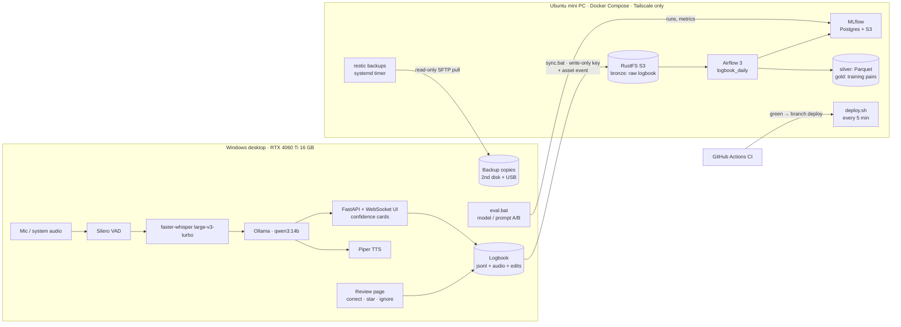

# LiveTranslator

[](https://github.com/yiweidong605-spec/LiveTranslator/actions/workflows/ci.yml)

**Offline, real-time speech translation between Chinese and French / English — plus the small ML
platform around it that evaluates models, collects daily conversations as training data, and deploys
itself.**

> 中文使用说明：[README.zh-CN.md](README.zh-CN.md)

I am a Chinese student in France looking for an internship; many offers ask for C1 French. LiveTranslator
runs entirely on my own GPU (no cloud, works without internet) and translates both sides of a
conversation: face-to-face, video interviews (system audio), or typed text. Every translation carries a
confidence card, every conversation lands in a WeChat-style review log, and my corrections become training
pairs for later fine-tuning.

The repository is also a deliberately complete, reproducible project: model selection backed by a test
set and statistics, an Airflow + MLflow platform on a separate Linux node, CI/CD, backups and security
checks — the parts that usually stay invisible in a demo.

---

## Highlights

| | |
|---|---|
| **Real time, offline** | ~0.25 s speech recognition + ~0.5 s translation per sentence on an RTX 4060 Ti 16 GB |
| **Chosen by data** | 8 local LLMs evaluated on a 246-sentence zh⇄fr/en test set with paired bootstrap significance; prompt changes are A/B-tested with fixed seeds |
| **Per-sentence confidence** | ASR word probabilities × LLM token log-probabilities, shown as an attribute card (and honestly measured: it is not calibrated yet) |
| **Learning loop** | Review page → corrections / stars → Airflow builds a Parquet dataset, daily quality metrics and a training-pair set |
| **Platform** | PostgreSQL · RustFS (S3) · MLflow · Airflow 3 on an Ubuntu mini PC, reachable only over Tailscale |
| **Operations** | GitHub Actions CI (31 tests, lint, secret scan, DAG integrity) → pull-based CD with automatic rollback · restic 3-2-1 backups · read-only security audit |

## Architecture



The real-time app never depends on the platform: if the mini PC is off, translation keeps working and
evaluation results fall back to a local MLflow database.

## The real-time pipeline

| Stage | Component | Notes |
|---|---|---|
| Segmentation | Silero VAD v6 (streaming, 512-sample frames) | sentence ends after 600 ms of silence; mic muted while TTS speaks |
| Recognition | faster-whisper `large-v3-turbo` on CUDA | word timestamps + probabilities, hotwords for names |
| Translation | Ollama, `qwen3:14b` | streaming, `think: false`, last 4 turns as context, glossary enforced, *vous* with interviewers |
| Speech | Piper (`fr_FR-siwis`, `en_US-lessac`) | optional; output to any device (e.g. a virtual cable for video calls) |
| Logbook | jsonl per day + audio per sentence | edits are stored separately, the original record is never modified |

## Model selection

`eval.bat` → `scripts/eval_mt.py`: chrF/BLEU (sacreBLEU), keyword checks for terms that must be right,
ambiguity sentences with and without context, confidence-vs-quality correlation, 95 % bootstrap
confidence intervals and P(first is better). Runs are logged to MLflow with the test-set hash.

Test set v1.1: 246 sentences — interviews, work, daily errands, street talk, slang, ASR noise, ambiguity,
English. Results (2026-11-06, glossary on):

| Model | chrF | 95 % CI | Keywords | Ambiguity w/ context | fr→zh | zh→fr | Latency (avg / p90) |
|---|---|---|---|---|---|---|---|
| **qwen3:14b** | **51.8** | 48.3–55.2 | **92 %** | **100 %** | **45.9** | 62.8 | 0.47 / 0.76 s |
| qwen2.5:14b | 50.9 | 47.4–54.5 | 91 % | 94 % | 42.1 | 59.1 | 0.52 / 0.77 s |
| gemma3:12b | 50.0 | 46.4–53.5 | 91 % | 81 % | 36.7 | **65.6** | 0.54 / 0.79 s |
| qwen3:8b | 48.0 | 44.6–51.6 | 85 % | 94 % | 40.1 | 58.6 | 0.28 / 0.43 s |
| qwen2.5:7b (first default) | 44.2 | 41.0–47.5 | 79 % | 94 % | 34.0 | 54.9 | 0.26 / 0.44 s |
| HY-MT1.5-7B (translation-specific) | 43.4 | 40.4–46.6 | 72 % | 75 % | 35.2 | 54.6 | 0.31 / 0.46 s |

Findings: the top three are not statistically separable overall, but per direction they are —
qwen3:14b is clearly better at understanding French (fr→zh, the critical path in an interview) and
gemma3:12b writes more natural French. Translation-specific models did **not** beat general LLMs on
spoken language. Full write-up and the other two models are in the run report.

### Prompt A/B test (2026-11-14)

A prompt that tells the model to translate slang by meaning (v2) looked better on one run. With
fixed seeds (42, 7) and both prompts on the same model:

| Metric | v1 | v2 | Δ | Seed-to-seed spread | Verdict |
|---|---|---|---|---|---|
| chrF overall | 51.1 | 51.4 | +0.2 | 0.7 | noise |
| Street talk | 43.8 | 47.8 | +4.0 | 2.2 | better |
| Slang | 29.1 | 30.9 | +1.8 | 3.7 | noise |
| Ambiguity (chrF) | 53.8 | 48.6 | −5.2 | 2.8 | **worse** |
| Keywords | 89.5 % | 86.0 % | −3.5 | 0.0 | **worse** |

v2 invented a dish ("un avocat" at a restaurant → *escargots*) in both seeds: "use the equivalent
expression" was read as permission to substitute. **v1 stays in production**; v2 is kept for comparison.
A unit test also guarantees that no prompt example appears in the test set — it caught exactly that in
the first draft.

## Confidence per sentence

`overall = ASR confidence × MT confidence`, each a blend of geometric-mean and minimum token
probability. The card shows weak words, the model's alternatives, latency, context used and the audio.
Measured against quality it is **weak** (Spearman 0.15–0.50, and it can say 100 % on a literal
mistranslation), so the plan is glass-box quality estimation features (Fomicheva et al., 2020),
semantic entropy (Farquhar et al., 2024), CometKiwi, then calibration with AUROC/ECE.

## Learning loop: from conversations to training data

`sync.bat` (runs only when started, no background process) uploads new/changed logbook files with an
MD5 check, then emits an Airflow **asset event**. `logbook_daily` (also scheduled daily as a safety net):

- finds changed dates by fingerprint (raw file ETag + that day's edits + pipeline version);
- **bronze → silver**: validates every line (bad lines go to quarantine, not to the floor), de-duplicates,
  merges edits (latest wins, undo supported), writes typed Parquet with a fixed schema;
- **gold**: daily metrics to MLflow (utterances, confidence, low-confidence rate, corrections, latency),
  the 10 sentences most worth reviewing, and training pairs (corrections + starred translations, ignored
  ones excluded);
- dynamic task mapping per date; idempotent; a failed date is retried next run while the others commit.

## Platform

| Service | Role | Exposure |
|---|---|---|
| PostgreSQL 17 | metadata for MLflow and Airflow | localhost only |
| RustFS | S3-compatible object store (MinIO community edition was archived in 2026) | localhost → Tailscale |
| MLflow ≥ 3.15 | experiments, artifacts proxied to S3 | localhost → Tailscale |
| Airflow 3.4 | LocalExecutor; api-server, scheduler, dag-processor, triggerer | localhost → Tailscale |

Design choices worth noting:

- Docker-published ports bypass `ufw`, so every port binds to 127.0.0.1 and `tailscale serve` exposes it
  to my devices only.
- **Least privilege everywhere**: the desktop's S3 key can only *write* under `lt-logs/raw/` (not read,
  list or delete); its Airflow account can only create asset events; the backup account is read-only
  SFTP with no shell; the deploy key is read-only for this one repository.
- Secrets are generated on the node (`gen-env.sh`), never committed (gitleaks runs in CI).

## Operations

- **CI** (`.github/workflows/ci.yml`): ruff, shellcheck, `docker compose config`, gitleaks over the full
  history, 25 unit tests, and a DAG-integrity job that imports every DAG with Airflow 3.4.0.
- **CD, pull-based**: a green build moves branch `deploy`; the node polls it every 5 minutes, restarts
  only what changed, **rolls back** if the stack fails to start, never retries a known-bad commit and
  refuses to deploy over manual edits on the server. GitHub holds no credentials for the node.
- **Backups (3-2-1)**: daily `pg_dump` + S3 mirror + config into restic (7 daily / 4 weekly / 12 monthly,
  weekly integrity check); the desktop pulls copies to a second physical disk and to an offline USB drive.
  Run by systemd, *not* by Airflow — a backup must not depend on what it backs up.
- **Monitoring**: hourly `platform_healthcheck` (storage round trip, MLflow, internet via four
  independent probes, disk, backup age), results in MLflow tagged with the deployed commit.
- **Security audit**: `infra/platform/security-audit.sh` — read-only incident-response checklist (logins,
  accounts, keys, tailnet devices, listeners, persistence, suspicious processes, package integrity).

## Engineering notes

Short write-ups of problems that taught something:

- **"The mini PC keeps losing internet"** — it didn't. The health check probed one site (neverssl.com, a
  single AWS host) that answered only ~30 % of connections from my network. Ruled out the link (0 % ping
  loss), Docker/ufw (host and containers failed randomly alike) and port 80 (same IP fine over http and
  https) before finding it. Fix: four independent probes, healthy if any succeeds, failures classified as
  portal / DNS / timeout / no route.
- **A misleading error**: `Network is unreachable` was the IPv6 fallback's error; the real failure was a
  10-second IPv4 timeout. Probes now force IPv4 on a network that has no IPv6.
- **`ssh -T git@github.com` always exits 1**, so under `set -o pipefail` a successful authentication
  check looked like a failure.
- **Sampling noise**: a single evaluation run reported 100 % on ambiguity; with fixed seeds v1 scores
  94 %. Comparisons now use seeds and report the seed-to-seed spread.

## Repository layout

```
app/                 real-time app: VAD, ASR, translation, confidence, logbook, FastAPI server, web UI
scripts/             evaluation (eval_mt, eval_asr), MLflow wiring, sync_logs, backup_pull, setup wizard
data/eval/           test set (jsonl) + changelog
tests/               pytest: logbook transform, probes, sync, prompts, DAG integrity
infra/platform/      docker-compose, Dockerfiles, Airflow DAGs (+ lt_lib), backup, deploy, security audit
*.bat                Windows entry points: setup, run, eval, sync, package
```

## Getting started

**Desktop (Windows, NVIDIA GPU recommended)** — double-click `setup.bat` (creates a local Python env,
installs CUDA libraries, downloads Whisper and Piper voices, installs Ollama and the recommended model
for your VRAM), then `run.bat`. The UI opens at http://127.0.0.1:7860. Everything stays inside the project
folder.

**Platform (optional, Ubuntu + Docker)** — see [infra/platform/README.md](infra/platform/README.md):
`./gen-env.sh`, `docker compose up -d`, `./tailscale-serve.sh`, then the backup and deploy installers.

**Tests** — `pip install -r requirements-ci.txt && pytest -m "not airflow"`; the DAG tests additionally
need `apache-airflow==3.4.0`.

## Roadmap

- [x] Phase 0 — prototype: offline speech-to-speech translation, confidence cards, review log
- [x] Phase 1 — model selection by evaluation (native-speaker review of the test set, COMET and
      confidence calibration still to do)
- [x] Phase 3 — platform: Airflow, MLflow, data pipeline, CI/CD, backups
- [ ] Phase 2 — packaging: `src/` layout, pyproject packaging, more tests
- [ ] Phase 4 — memory: people, catchphrases and running jokes from past conversations as context
- [ ] Phase 5 — fine-tuning on accumulated training pairs (LoRA), nightly evaluation on the GPU node
- [ ] Phase 6 — phone / street mode
